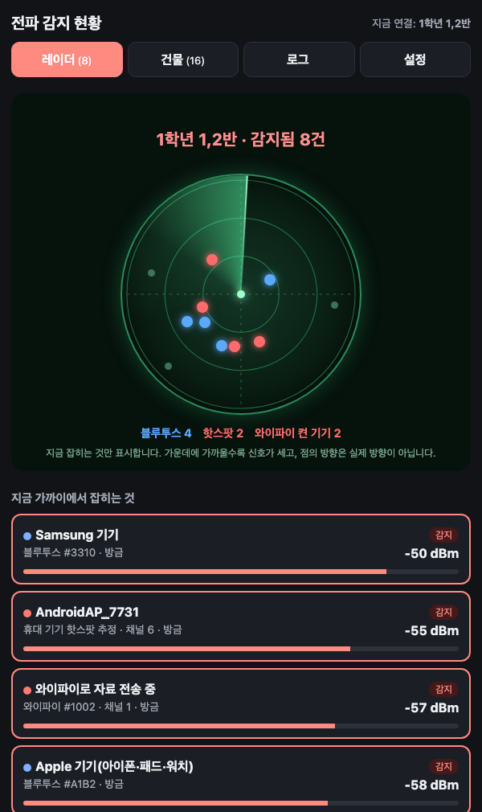
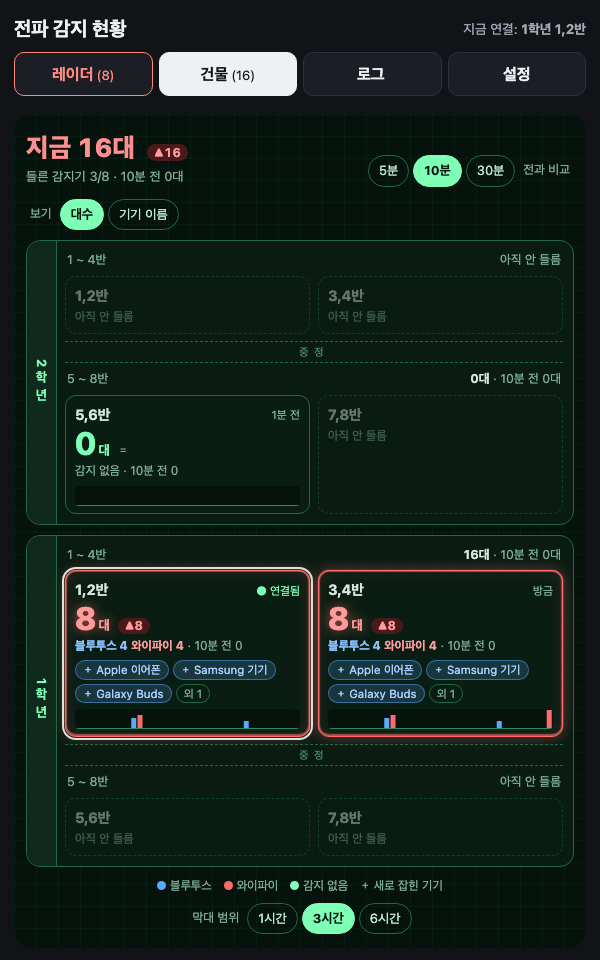
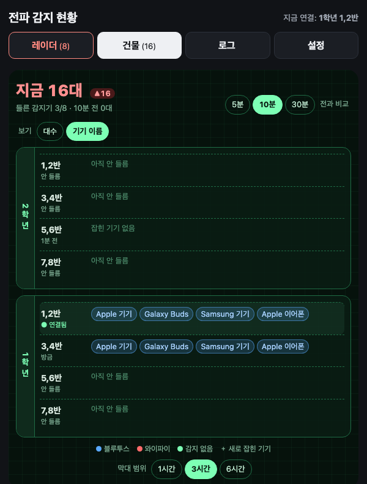

# bt-scout · 교실 전파 감지기

시험 중 교실 안에서 **블루투스나 와이파이가 켜진 기기**가 있는지 복도에 둔 작은 보드(Raspberry Pi Pico 2 W)가 찾아 알려 줍니다. 학교 와이파이도 인터넷도 필요 없습니다. 휴대전화로 감지기에 직접 붙어 레이더 화면과 건물 화면으로 확인합니다.

| 레이더 모드 | 건물 모드 | 건물 모드(기기 이름) |
|---|---|---|
|  |  |  |

위 화면은 컴퓨터에서 가상 자료로 띄운 예시입니다.

> **이 도구만으로 모든 부정행위를 잡을 수는 없습니다.** 블루투스·와이파이를 켠 기기를 찾는 **보조 수단**입니다. 꺼진 기기, 비행기 모드, 이동통신(LTE·5G)만 쓰는 전화, 저장만 하는 카메라는 보이지 않습니다. 감지되었다고 부정행위라는 뜻도 아닙니다. [한계](#한계)를 먼저 읽어 주세요.

---

## 무엇을 잡나

| 대상 | 잡히는가 |
|---|---|
| 블루투스를 켠 무선 이어폰, 스마트안경, 스마트워치, 휴대전화, 태블릿 | 잡힘 |
| 핫스팟을 켠 전화, 기기 간 직접 연결(Wi-Fi Direct) | 잡힘 (2.4GHz일 때) |
| 와이파이만 켜 둔 전화 | 피코만으로는 안 잡힘. ESP32 보드를 더하면 잡힘(선택) |
| 5GHz 전용 핫스팟 | 안 잡힘 |
| 이동통신(LTE·5G)만 쓰는 전화 | 안 잡힘 |
| 꺼진 기기, 비행기 모드, 저장만 하는 카메라·녹음기, 귓속 수신기 | 안 잡힘 |

## 준비물

| 부품 | 필수 여부 | 비고 |
|---|---|---|
| Raspberry Pi Pico 2 W (또는 2 WH) | **필수** | "2"와 "W"가 모두 붙은 모델. 블루투스가 있어야 합니다. |
| 마이크로 USB 케이블(데이터 겸용), USB 전원 | **필수** | 충전기나 보조배터리 |
| LED | **선택** | 없어도 됩니다. 피코 본체의 작은 LED와 휴대전화 화면으로 확인할 수 있습니다. |
| Grove Shield for Pi Pico | 선택 | LED를 납땜 없이 꽂을 때 편합니다. |
| ESP32 보드, 광대역 전파 센서 | 선택 | 실험 단계. [docs](docs) 참고 |

LED를 달 경우 색이 바뀌는 LED 줄(네오픽셀: WS2812·WS2813, 예: Grove RGB LED Stick 10개, LED 띠 60개)을 권합니다. 색이 하나인 LED 한 개도 됩니다.

## 빠른 시작 (감지기 1대, 약 15분)

1. **MicroPython 넣기**: micropython.org의 Download에서 **Raspberry Pi Pico 2 W**용 `.uf2`를 받습니다. 피코의 BOOTSEL 단추를 누른 채 USB를 꽂고, 나타난 드라이브에 `.uf2`를 끌어다 놓습니다.
2. **파일 4개 올리기**: [Thonny](https://thonny.org)에서 `firmware` 폴더의 `main.py`, `detect.py`, `config.py`, `page.html`을 피코에 올립니다.
3. **암호 바꾸기**: 피코 쪽 `config.py`의 `AP_PASSWORD`를 바꿉니다. 기본값 `12345678`은 공개된 값이니 **학교에서 쓸 때는 꼭 바꾸세요.**
4. **켜기**: USB를 뽑았다 꽂습니다. Thonny 창에 `감지기 1학년 1,2반 시작…`이 찍히면 정상입니다.
5. **보기**: 휴대전화의 **블루투스를 끄고**, 와이파이 `SCOUT`에 붙은 뒤 브라우저 주소창에 `http://192.168.4.1`을 넣습니다.

화면이 안 열리면: 휴대전화의 모바일 데이터를 잠깐 끄고, 주소를 `http://`까지 넣었는지, 와이파이가 여전히 `SCOUT`인지 확인합니다. Thonny에서 정지 단추를 누르면 프로그램이 멈추니 Ctrl+D로 다시 시작합니다.

처음 하는 분을 위한 그림 안내서는 [docs/0_바로시작.pdf](docs/0_바로시작.pdf), [docs/1_피코편.pdf](docs/1_피코편.pdf)에 있습니다.

## 화면

| 탭 | 내용 |
|---|---|
| **레이더** | 지금 연결된 감지기가 잡고 있는 기기. 가운데에 가까울수록 신호가 셉니다. 점의 방향은 실제 방향이 아닙니다. |
| **건물** | 감지기 여러 대의 현황을 학년·반 위치대로 한 화면에. 반별 대수, n분 전과의 비교, 새로 잡힌 기기 이름. "기기 이름" 보기로 바꾸면 위치별 이름만 봅니다. |
| **로그** | 조금 전까지 잡히던 기기, 감지 기록(최근 6시간), 약한 신호. '지금'으로 보는 시간(10·20·60초)을 고릅니다. |
| **설정** | 감지 세기 기준, 기준 측정, 모아 둔 기록 지우기 |

**기준 측정**은 학생이 없는 빈 교실에서 누릅니다. 전자칠판처럼 늘 켜져 있는 기기와 주변 공유기를 기억해 감지에서 뺍니다. 학생이 있을 때 누르면 학생의 기기가 감지되지 않게 되니 주의하세요.

## 감지기 여러 대 쓰기

- 모든 감지기의 와이파이 이름(`AP_SSID`)과 암호를 같게 둡니다. 복도를 걸으면 휴대전화가 가까운 감지기로 옮겨 붙습니다.
- 감지기는 모두 주소가 `192.168.4.1`입니다. 그래서 브라우저가 각 감지기에서 받은 기록을 한곳에 모으고, **건물** 탭에 함께 보여 줍니다. 기록은 그 휴대전화의 브라우저에만 저장됩니다.
- 감지기마다 `config.py`의 `GRADE`, `CLASSES`, `AP_CHANNEL`만 다릅니다.

감지기별 설정 묶음을 한 번에 만들 수 있습니다.

```bash
cp tools/school.example.json tools/school.json
```

`tools/school.json`을 학교에 맞게 고친 뒤 실행합니다.

```bash
python3 tools/make_units.py
```

`dist/` 아래에 감지기마다 zip이 하나씩 생기고, zip 안의 파일 4개를 그대로 피코에 올리면 됩니다.

## LED (선택)

LED는 없어도 됩니다. 달면 복도에서 한눈에 볼 수 있습니다. 쉴드의 **D16** 포트(GP16)에 꽂습니다.

| LED 줄 | 뜻 |
|---|---|
| 첫 칸이 초록 | 정상, 감지 없음 |
| 파랑 칸 | 블루투스 기기. 켜진 칸 수가 잡힌 수 |
| 빨강 칸 | 와이파이(핫스팟 등). 켜진 칸 수가 잡힌 수 |
| 초록이 번갈아 깜박 | 기준 측정 중 |

- `config.py`의 `LED_COUNT`만 LED 개수(10, 60 등)에 맞추면 됩니다. 표시는 항상 10칸이고, 60개면 한 칸이 LED 6개입니다.
- LED만 따로 시험하려면 `simple/led_test.py`를 Thonny에서 실행합니다.
- 색이 하나인 LED 한 개를 쓰려면 `LED_TYPE = "single"`로 바꿉니다(3초마다 반짝 = 정상, 계속 켜짐 = 감지).

## 설정 (`firmware/config.py`)

| 설정 | 기본값 | 뜻 |
|---|---|---|
| `GRADE`, `CLASSES` | `1`, `"1,2"` | 이 감지기가 맡은 학년과 반. 화면 이름이 "1학년 1,2반"이 됩니다. |
| `AP_SSID`, `AP_PASSWORD` | `"SCOUT"`, `"12345678"` | 감지기가 만드는 와이파이. **암호는 꼭 바꾸세요.** |
| `AP_CHANNEL` | `1` | 이웃 감지기끼리 1, 6, 11을 번갈아 씁니다. |
| `RSSI_MIN` | `-75` | 이 세기 이상을 '교실 안'으로 봅니다. 화면에서도 바꿀 수 있습니다. |
| `PERSIST` | `10` | 이 시간(초) 이상 계속 잡혀야 감지. 복도를 지나가는 사람을 거릅니다. |
| `HOLD` | `60` | 마지막으로 잡힌 뒤 감지 상태를 유지하는 시간(초) |
| `WIFI_SCAN` | `True` | 핫스팟 탐지. 화면 접속이 자주 끊기면 `False` |
| `LED_TYPE`, `LED_COUNT`, `LED_BRIGHT` | `"stick"`, `10`, `40` | LED 종류, 개수, 밝기 |
| `HISTORY_HOURS` | `6` | 화면에 보여 줄 기록 시간 |

## 우리 학교에 맞게 바꾸기

### 설정만으로 되는 것
- **감지 거리**: 교실 가장 먼 자리에 블루투스를 켠 전화를 놓고 화면의 세기(dBm)를 본 뒤, 설정 탭에서 기준을 그보다 조금 낮게 맞춥니다.
- **와이파이 이름·암호, LED 개수·밝기, 기록 시간**: 위 표의 값을 바꿉니다.
- **감지기 수**: `tools/school.json`의 `units`에서 줄이거나 늘립니다.

### 구조가 다르면 AI에게 맡기세요
이 저장소의 기본값은 "2개 학년, 학년당 8반, 감지기 1대가 2개 반"입니다. 학교 구조가 다르면 화면 배치 코드(`firmware/page.html`)도 바꿔야 합니다. Claude, ChatGPT 같은 AI 도구에 이 저장소를 주고 아래처럼 요청하면 됩니다.

```text
이 저장소는 교실 블루투스·와이파이 감지기입니다. 우리 학교에 맞게 바꿔 주세요.
- 학년: 3개 학년, 학년당 10반
- 감지기 1대가 맡는 반: 2개 반씩(1,2 / 3,4 / … / 9,10)
- 건물: 일자형 복도, 학년마다 한 층
바꿀 곳: firmware/config.py의 설정표 주석, firmware/page.html의 GRADES·PAIRS와 건물 탭 배치,
tools/school.example.json의 units.
바꾼 뒤 python3 -m unittest discover -s tests 를 돌려 통과하는지 확인해 주세요.
```

다른 요청 예시입니다.

```text
감지기 이름을 "학년·반" 대신 "본관 2층 동쪽"처럼 자유롭게 쓸 수 있게 바꿔 주세요.
config.py에 NAME 하나만 두고, 건물 탭은 이름 순서대로 2열로 보여 주세요.
```

```text
LED를 쓰지 않습니다. LED 관련 코드를 건드리지 말고, config.py의 LED_TYPE을 "single"로 두었을 때
피코 본체의 LED만으로 상태를 알 수 있는지 확인하고 README에 맞게 설명해 주세요.
```

```text
건물 탭의 "n분 전과 비교"에 1분과 3분을 추가하고, 기본값을 5분으로 바꿔 주세요.
```

요청할 때 알려 주면 좋은 것: 학년·반 수, 감지기 수와 놓을 자리, 감지기 1대가 맡을 교실, LED 유무와 개수, 화면에서 보고 싶은 것. AI가 고친 뒤에는 `tools/preview_server.py`로 화면을 미리 보고, 실제 피코 1대로 먼저 확인하세요.

## 한계

- **잡히지 않는 것이 많습니다.** 꺼진 기기, 비행기 모드, 블루투스와 와이파이를 모두 끈 채 이동통신만 쓰는 전화, 저장만 하는 카메라, 받기만 하는 수신기는 보이지 않습니다.
- **초록이라고 기기가 없는 것이 아니고, 감지되었다고 부정행위인 것도 아닙니다.** 끄는 것을 잊은 워치일 수 있습니다. 판단은 직접 확인한 뒤에 합니다.
- **교실을 정확히 가르지 못합니다.** 감지기 1대가 맡은 교실들 중 어디인지, 옆 교실이나 위아래층인지는 신호 세기로 짐작할 뿐입니다.
- **거리는 건물마다 다릅니다.** 콘크리트 벽 한 장 너머로 대략 5~12m가 추정치이며, 이어폰처럼 약한 기기는 더 짧습니다. 반드시 현장에서 재 보세요.
- **누구의 기기인지 알 수 없습니다.** 휴대전화와 이어폰은 주소를 수시로 바꿉니다.
- **기록은 전원이 꺼지면 사라집니다.** 감지기에는 최근 6시간만 메모리에 있습니다.
- **확인하는 사람의 기기도 잡힙니다.** 화면을 볼 때는 블루투스를 끄세요. 감독 교사의 워치·이어폰도 마찬가지입니다.

이동통신까지 확인하려면 휴대용 전파 탐지기 같은 별도 장비가, 꺼진 기기는 금속 탐지기나 육안 확인이 필요합니다.

## 개인정보와 운영

- 감지기는 주변 기기가 내보내는 신호의 **종류와 세기만** 봅니다. 통신 내용은 읽지 않으며 서버로 보내지 않습니다.
- 학생에게 블루투스·와이파이 신호를 감지한다는 사실을 미리 알리는 것을 권합니다.
- 소지품 확인은 학교의 규정과 절차를 따르세요.
- 와이파이 암호를 아는 사람은 누구나 화면에서 기준 측정을 누를 수 있습니다. 암호는 감독 교사끼리만 공유하세요.

## 확인된 것과 아닌 것

- 확인됨: 피코 1대에서 블루투스 감지, 휴대전화 접속과 화면, LED 줄 표시.
- 컴퓨터에서 가상 자료로만 확인됨: 판정 논리(시험 24개), 감지기 여러 대의 기록 합치기.
- **아직 실물로 확인하지 못함**: 감지기 8대를 동시에 켰을 때 휴대전화가 옮겨 붙는 동작, 핫스팟 탐지와 화면 접속의 동시 동작, ESP32 청취기, 광대역 전파 센서.

문제가 생기면 Thonny 창에 찍히는 글과 피코 안의 `error.txt`를 확인하세요.

## 컴퓨터에서 시험하기 (피코 없이)

```bash
python3 -m unittest discover -s tests
```

```bash
python3 tools/preview_server.py
```

두 번째 명령을 켜 둔 채 `http://localhost:8765`를 열면 가상 기기로 화면을 미리 볼 수 있습니다.

## 폴더

```
firmware/        피코에 올리는 파일 4개 (main.py, detect.py, config.py, page.html)
simple/          한 파일짜리 심플 버전, LED 시험, 와이파이 시험
tools/           감지기별 설정 묶음 만들기, 화면 미리보기
tests/           판정 논리 시험
docs/            처음 하는 분을 위한 안내서(PDF·HTML)
esp32_sniffer/   (선택·실험) ESP32 와이파이 청취기
```

## 라이선스

MIT. 자유롭게 고쳐 쓰셔도 됩니다. 학교 현장에서 써 보신 결과나 고친 내용을 이슈로 알려 주시면 도움이 됩니다.
